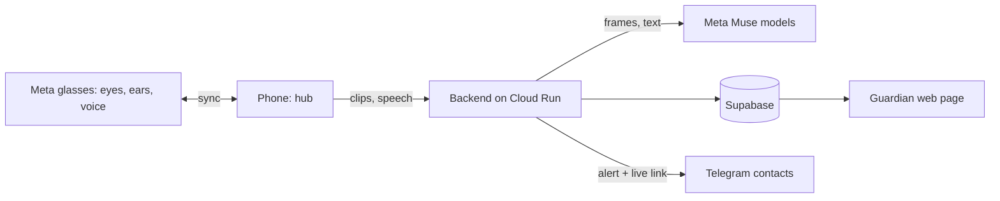

# Safeguard

**Demo video:** <!-- add link here -->

Safeguard is a personal-safety system for women, designed for **Meta glasses**. The glasses are the eyes: they see what the wearer sees, hear what she hears, detect danger, and speak to her directly. A paired phone stays in sync as the hub for connectivity, alerts and recording.

This repository is a working demonstration of that system. Meta glasses are not yet available as a developer camera source, so the demo uses an iPhone camera in their place. Any body camera or phone camera can play the same role. The detection, judgment, voice check-in, alerts and guardian review shown here are exactly what the glasses would drive.

> Safeguard judges behaviour only: movement, approach, gestures, persistence. It never considers appearance, identity or clothing.

## The idea

| Role | Meta glasses | Demo stand-in |
|---|---|---|
| Eyes: first-person camera | Glasses camera | iPhone camera or any body cam |
| Ears: microphone | Glasses microphone | iPhone microphone |
| Detector: people, gestures, expressions | Runs on the glasses, synced to the phone | Runs on the iPhone |
| Voice to the wearer: "Are you safe?" | Glasses speakers, private and hands-free | Phone speaker |
| Hub: network, alerts, recording | Paired phone, in sync at all times | The same iPhone |

The camera source and the spoken check-in sit behind narrow interfaces, so the glasses replace the stand-in without changing detection, judgment or escalation.

## End-to-end flow

1. **Sign in.** An account is required. A profile photo is optional.
2. **Protect.** The wearer starts protection. The camera watches and the microphone listens.
3. **Detect on the device.** People, hand gestures and facial expressions are read in real time. Repeated hostile gestures, a distress word, shouting or an unsafe phrase raise concern.
4. **Judge in the cloud.** Short clips and speech snippets go to Meta's Muse model, which rates the threat from behaviour alone.
5. **Ask.** The wearer is asked by voice whether she is safe. A safe phrase or a tap cancels it.
6. **Countdown.** With no reply, a cancellable countdown starts.
7. **Escalate automatically.** Contacts and the guardian get a Telegram alert with a live link and map pin. Video and sound stream to the cloud as one continuous recording. A ride link is prepared. Only the police call is left to the wearer, by design.
8. **Review.** The guardian watches live from any browser, then plays the incident as a single recording with sound.

Also included: a safe-arrival timer, helplines (112, 1091, 181), nearby police and hospitals, and an offline mode if the server is unreachable.

## Technology and where it is used

### Meta models

| Model | Role |
|---|---|
| **Muse Spark** (Meta Model API) | Multimodal threat judgment over short first-person clips: behaviours, objects in hand, approach, persistence. Also judges conversation snippets. Returns strict JSON. |
| **Muse voice transcription** (Meta realtime speech recognition) | Streaming Hindi and English recognition of distress words and unsafe phrases, relayed through the backend so keys never reach the device. |

### Other components

| Layer | Technology |
|---|---|
| iOS app | Swift, SwiftUI, iOS 17 |
| Person detection | Apple Vision |
| Gestures and expressions | MediaPipe Tasks Vision (hand gestures, face blendshapes) |
| On-device speech | Apple Speech |
| Recording | AVAssetWriter, fragmented MP4 (HLS), AAC audio, uploaded as it is written |
| Maps and nearby help | MapKit |
| Backend | FastAPI (Python) on Google Cloud Run, scales to zero |
| Accounts and storage | Supabase Auth, Postgres (profiles with row-level security), Storage (recordings, state, photos) |
| Alerts | Telegram bot by webhook |
| Guardian page | Server-rendered page with hls.js playback and signed media links |

## Principles

- **Behaviour, never identity.** Prompts and rules exclude appearance entirely.
- **Automatic except the police call.** Safeguard never dials by itself.
- **Private by default.** Detection runs on the device. Keys stay on the server. Passwords are never stored by Safeguard. Transcripts are not logged.
- **Cheap to run.** One Cloud Run instance, none kept warm, with a cost check on every deploy.

## Layout

- `ios/` native app
- `backend/` FastAPI service and tests
- `supabase/` database migrations
- `scripts/` build, test, deploy and cost-check scripts
- `deploy/` hosting guide

## Status

A working demo with an iPhone camera as the stand-in for Meta glasses. Next: the glasses as the live camera and microphone source, with spoken prompts to the wearer.
