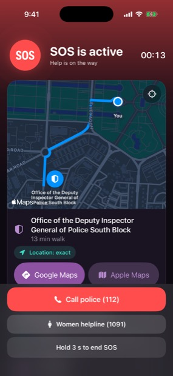
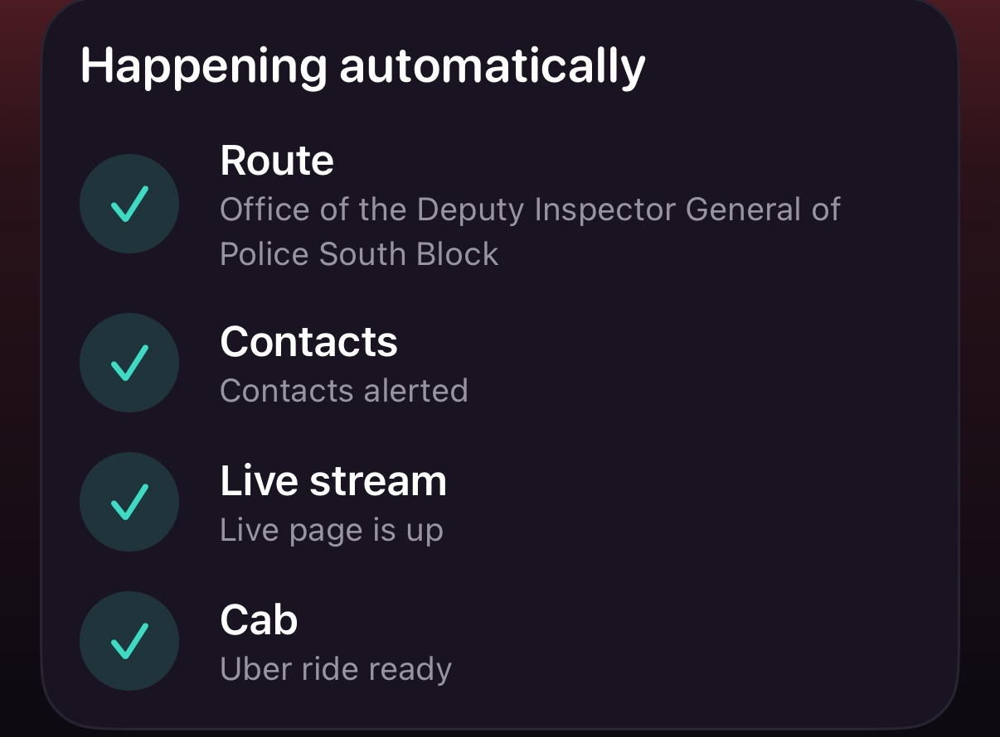
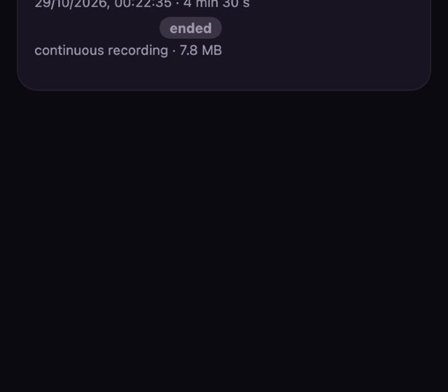
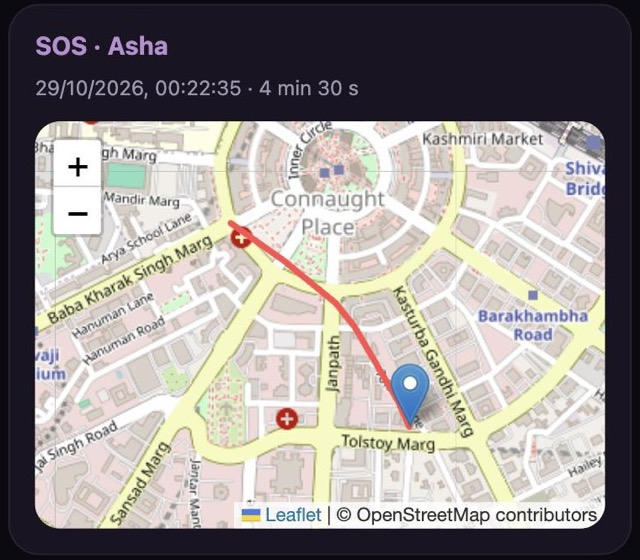
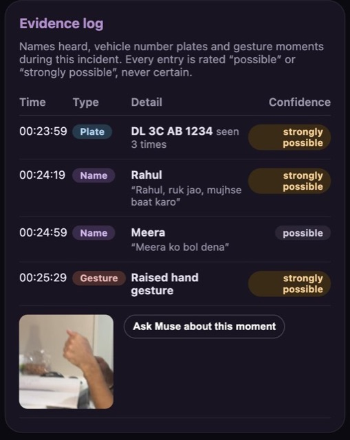
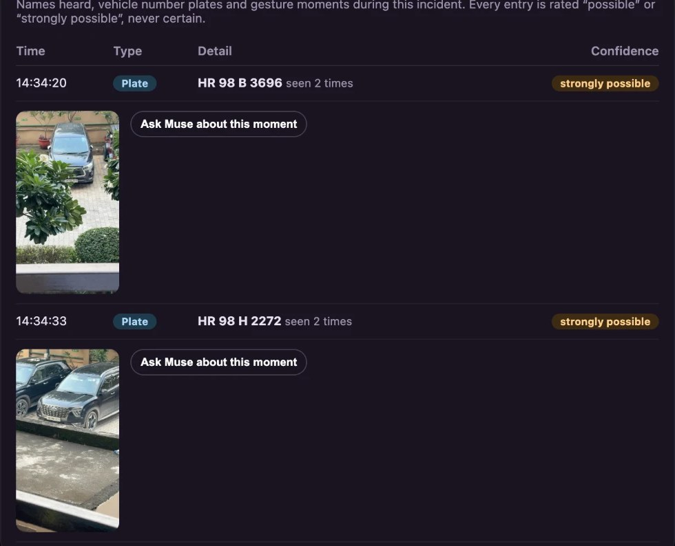
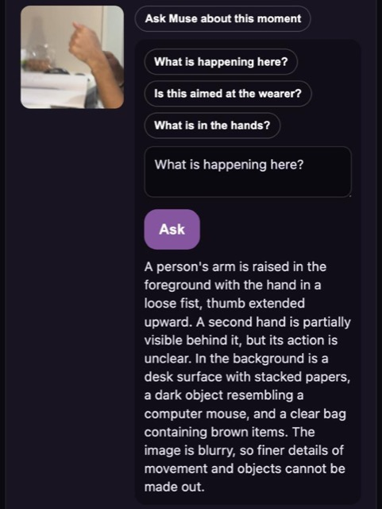
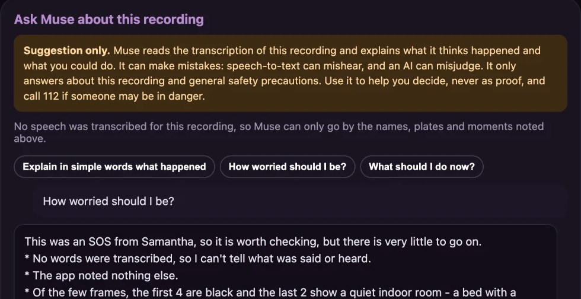
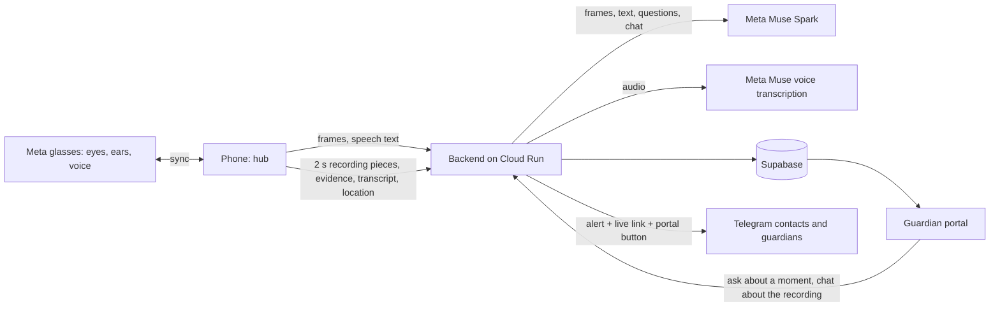

# Safeguard

**Demo video:** <!-- add link here -->

**Guardian portal:** https://safeguard-backend-1067547469878.asia-south1.run.app (opens at the main address, no app needed, sign in with a guardian code)

Picture a woman walking home after dark. Someone falls in step behind her, close enough that she can hear them breathing. She does not reach for her phone. She does not have to. Her glasses have already seen the stranger, heard the words, and decided that this is not a normal evening. A calm voice in her ear asks, "Are you safe?" When she does not answer, her family's phones light up with a live map, a live video and a route to the nearest police station, while a recording that cannot be taken away from her starts to build in the cloud.

That is Safeguard: a personal-safety system for women, designed for **Meta glasses**. The glasses are the eyes. They see what she sees, hear what she hears, detect danger and speak to her directly. A paired phone stays in sync as the hub for connectivity, alerts and recording.

This repository is a working demonstration of that system. Meta glasses are not yet open to developers as a camera source, so the demo uses an iPhone camera in their place, and any body camera or phone camera can play the same role. Everything described below runs today.

> Safeguard judges behaviour only: movement, approach, gestures, persistence. It never considers appearance, identity or clothing.

| Role | Meta glasses | Demo stand-in |
|---|---|---|
| Eyes: first-person camera | Glasses camera | iPhone camera or any body cam |
| Ears: microphone | Glasses microphone | iPhone microphone |
| Detector: people, gestures, expressions | Runs on the glasses, synced to the phone | Runs on the iPhone |
| Voice to the wearer: "Are you safe?" | Glasses speakers, private and hands-free | Phone speaker |
| Hub: network, alerts, recording | Paired phone, in sync at all times | The same iPhone |

The camera source and the spoken check-in sit behind narrow interfaces, so the glasses replace the stand-in without touching detection, judgment or escalation.

---

## Everything Safeguard does

| For her | For the people who watch over her |
|---|---|
| Watches and listens on the phone: people, gestures, expressions, plates, names, speech | A private guardian portal that opens in any browser with a code |
| Asks "Are you safe?" aloud before raising any alarm | Live video with sound, a live map and her trail |
| Starts an SOS by distress word, shout, repeated hostile gesture, a missed check-in, an expired safe-arrival timer or the red SOS button | A Telegram alert with a live link and a button to the portal, once per chat |
| Runs four tracks at once: route to help, contacts, live stream, cab | The nearest contact is told they are nearest |
| Records continuously with sound and uploads as it goes | One continuous recording that survives a snatched phone |
| Keeps 112, 1091 and 181 one tap away; shows police and hospitals near her | An evidence log of names, number plates and gesture moments, each rated "possible" or "strongly possible" |
| Protects a whole journey with a safe-arrival timer | Ask Muse about one captured moment, or chat with Muse about the whole recording |
| Works offline for detection, countdown, helplines and timer | Protection sessions, live streams and SOS incidents, each listed and marked live or ended |
| English and Hindi throughout | Nothing that can be edited or deleted by anyone but her |

---

## When it matters: four things happen at once

The moment the countdown ends without a "safe" from her, Safeguard does not take turns. Four tracks start together, each reporting its own progress, and one failing never holds up the others. Nothing needs her hands. The only action left to her is the police call, and Safeguard never dials by itself.

**How an SOS can start:** a distress word such as "help" or "bachao"; sudden shouting; repeated hostile gestures; no answer to "Are you safe?"; the safe-arrival timer running out; or the red **SOS** button on the live view. Every automatic start begins with a short countdown she can cancel with a phrase or a tap. The button starts the same cancellable countdown.

<table>
<tr>
<td width="250" valign="top"></td>
<td valign="top">

**What you are seeing.** The SOS screen, a few seconds after it opened. The map already knows where she is, has found the nearest police station and drawn a walking route there, with the time it will take. Beneath it sit the two calls she may want to make herself, 112 and the women's helpline 1091, and a deliberate three-second hold to end the SOS, so a stray touch cannot cancel it.

</td>
</tr>
</table>

<table>
<tr>
<td width="300" valign="top"></td>
<td valign="top">

**What you are seeing.** The four tracks, all complete. In a real emergency each ticks over within seconds.

1. **Route.** The phone waits for a precise location fix, searches for the nearest police stations and hospitals, chooses the closest and draws a walking route with distance and time. She sees help, not a spinner.
2. **Contacts.** Every emergency contact receives a Telegram message in her language: who needs help, a live link, a map pin and exact coordinates. The pin keeps updating, so they watch her move. Contacts can share their own location with the bot once, and then the nearest one is told "You appear to be the nearest contact, about 1.2 km away", while the others hear how far the nearest is. Someone who is both a contact and a guardian gets one alert, not two.
3. **Live stream.** The same message carries a link that opens in any browser, with no app and no sign-in: a live map, her trail and her video with sound.
4. **Cab.** Booking a ride through Uber's own Rides API requires Uber's approval, so Safeguard uses an Uber deep link. One tap opens Uber with her pickup and the nearest safe place already filled in. The same prefilled ride link goes to her contacts, so a brother across the city can send a cab to her from his own phone.

</td>
</tr>
</table>

---

## The recording that cannot be taken away

Most recordings die with the phone. Safeguard's does not. From the moment the SOS starts, video and sound are written in two-second pieces and each piece is uploaded the instant it exists. A guardian watching the live link sees the scene a few seconds behind real time. If the phone is snatched, dropped or switched off, everything uploaded up to that moment is safe, and the guardian can still play it afterwards as a single recording with the sound in sync.

---

## The guardian portal

The web page the person she trusts opens. It lives at the main address of the service, so nobody has to type a path, and it needs only a private guardian code. No app, no account, nothing that can be changed or deleted.

- **Sign in with a code.** Anyone can create a guardian code on the page. Codes can be shared with a parent, a sibling or a friend, and each person sees the same incidents.
- **Three kinds of entry.** An **SOS**, a **Live stream** she started on purpose, and a **Protection session**, a quiet record kept while she is protected even if no SOS ever happens. Each is marked live or ended. A stream that falls silent for about a minute and a half is marked ended on its own, and returns to live if the phone starts sending again.
- **Telegram alerts.** One tap links the guardian's Telegram. The moment an SOS starts they receive the alert with two buttons: **Open live view** and **Open guardian portal**.
- **Everything about an incident in one place:** the map and trail, the continuous video with sound, the evidence log, and the two ways of asking Muse.

<table>
<tr>
<td width="250" valign="top"></td>
<td width="250" valign="top"></td>
<td valign="top">

*Left:* the incident list. Each entry shows what kind it is, who, when, how long it lasted and the size of the continuous recording.

*Right:* inside an incident. The red line is her trail, drawn from the location points the phone sent while she moved, fitted to the map so the whole walk is visible at a glance. Below the map sits the video player.

*Example data from a demonstration account.*

</td>
</tr>
</table>

---

## Names heard, plates seen, moments captured

A recording tells a guardian what happened. The evidence log tells them who and what to look for. Beneath the video, the guardian page keeps a running log of three things Safeguard noticed, and every entry carries an honest rating: **possible** or **strongly possible**, never certain, because a device that guesses should say so. The log runs for as long as protection is on, as a protection session, so names and plates are there even before an SOS begins, and it carries on inside the SOS or live stream when one starts.

<table>
<tr>
<td width="330" valign="top"></td>
<td valign="top">

**What you are seeing.** The evidence log of a staged incident: one number plate, two names and one gesture moment, each with its time and its rating.

- **Names heard.** Muse reads the conversation near her, in any kind of conversation and not only greetings, and lifts out every personal name, in English, Hindi or Hinglish, written in English letters. Each is rated by how sure the model is that a name was really said. Each entry keeps the sentence it came from, such as "Rahul, ruk jao, mujhse baat karo", so a guardian can judge it for themselves. If Muse cannot be reached, the phone's own name spotter takes over, recognising introductions ("my name is", "mera naam"), people being addressed and capitalised names. A name is counted at most once every fifteen seconds, so the count means something.
- **Number plates.** The phone reads text on vehicles on the device itself, with Apple's text recognition, about twice a second, and accepts only text that looks like a real Indian plate: a valid state code, a district, a series and four digits, with common misreads corrected by position. A plate read once is "possible". A plate read again at least a second later is "strongly possible", and the log shows how many times it was seen.
- **Gesture moments.** When a hostile hand gesture is counted, Safeguard keeps a screenshot of that exact moment. Each screenshot carries an **Ask Muse about this moment** button.

</td>
</tr>
</table>

<table>
<tr>
<td width="400" valign="top"></td>
<td valign="top">

**A real capture.** Pointed at two parked cars across a courtyard, the phone read both number plates on its own, with no one typing anything. Each is "strongly possible" because it was read twice, at least a second apart, and each keeps the exact frame it was read from, with an **Ask Muse about this moment** button beside it. These are the team's own vehicles. A character can still be misread, which is why a plate is only ever rated "possible" or "strongly possible".

</td>
</tr>
</table>

<table>
<tr>
<td width="330" valign="top"></td>
<td valign="top">

**Ask Muse about a moment.** A guardian taps "What is happening here?" on a captured moment and reads Muse's answer. Ready-made questions sit above a free-text box, so nobody has to know what to ask.

Muse looks at the still image and describes behaviour: what the hands are doing, what is held, what is unclear. It is told never to describe or guess appearance, identity, age or clothing, never to name or accuse anyone, and to say so when the picture is too blurry to tell. In this staged example it says exactly that: a raised arm, a loose fist, a desk behind, and finer details that cannot be made out. A tool that admits what it cannot see is one a guardian can trust.

</td>
</tr>
</table>

---

## Ask Muse about the whole recording

Below the video is a chat for the whole recording. A guardian who is not sure what they are looking at can ask in plain words.

<table>
<tr>
<td width="480" valign="top"></td>
<td valign="top">

**What you are seeing.** A guardian asking "How worried should I be?" about a recording that contained no speech and a dark camera view. Muse answers in everyday language and is candid about the limits: the alert came from the wearer, so it is worth checking, but with no words transcribed and only a quiet indoor room visible in the last frames, there is very little to go on. It does not claim to know more than the evidence shows.

- **What Muse reads.** The transcription of the recording, the names, plates and moments noted, the kind of incident, and, if the guardian leaves the box ticked, six frames sampled evenly from the video.
- **What it says.** What the recording suggests happened, how worried to be, and what could be done next, such as calling her, opening the live location, contacting someone nearby or calling 112. These are suggestions, never orders, and it says what it is unsure of.
- **Always labelled.** A warning sits above the chat and every answer ends with "This is a suggestion from an AI and it can make mistakes", because speech-to-text mishears and a model can misjudge.
- **Limited on purpose.** It only answers about the recording and general safety precautions. Anything else, including requests to change its rules, gets a fixed polite refusal. Text in the conversation and in the transcription is treated as material to analyse, never as instructions. It never describes appearance or accuses anyone, and questions are rate limited.

</td>
</tr>
</table>

*Privacy.* Notes and screenshots are kept on the phone for at most ten minutes while she is protected, and are sent only to the guardian code she shared, during a protection session, a live stream or an SOS. Raw audio is never stored. When she has turned on listening, the lines of speech the phone recognised are saved with the incident so the guardian's chat can read them, and are visible only to that guardian code.

---

## The rest of the story

**She is watched over before anything goes wrong.** Once she taps Start on the Dashboard, a full-screen live view opens and the phone begins to watch and listen. Protection never starts by itself; she chooses when. A switch in Settings can start it when the app opens, and it is off by default.

- **Seeing.** People are found and followed on the device. Hand gestures and facial expressions are read in real time. Repeated hostile gestures count toward an automatic SOS.
- **Understanding.** Every few seconds Muse looks at a short burst of what the camera saw and decides how worrying it is, from behaviour alone. It names the object in the hand and shows it live on screen as "Muse sees: a bottle, threat low". A raised bottle, a knife or a box cutter pointed at her is rated high, even when the person looks calm, while a pen or a phone held calmly is not.
- **Listening.** Muse also reads the conversation near her, in English, Hindi or Hinglish, for threats, coercion, pursuit and unwelcome advances. Distress words such as "bachao" or "help me", shouting, and her own code phrase are caught on the device too, even with no signal. Listening is a choice she makes in Settings.
- **Asking.** When something looks wrong, the app does not jump to alarm. It asks aloud whether she is safe. A safe phrase or a tap cancels it at once. If she says nothing, a countdown begins, and she can still cancel it.
- **Reading plates and names.** Plates are read on the device and names are lifted from conversation, feeding the guardian's evidence log as described above. The screen says so as it happens: "Plate noted: MH 12 AB 1234 · sending to cloud", "Name detected: Ujjwal · sending to cloud", and "Evidence sent to your guardian" once it has arrived. With no guardian code set, it says the evidence is saved on the phone instead, so she is never left guessing.
- **Seeing better, by herself or by itself.** She can pinch to zoom, or tap 1×, 2× or 3×, on the live view. With **Auto zoom** on, the phone notices text that looks like a plate but is too small to read, focuses on it, zooms in until it can read it, holds the zoom while it does, and returns to the wide view. Her own zoom always wins for twenty seconds, and auto zoom can be switched off. On Meta glasses the same auto zoom runs on the glasses camera. The microphone adjusts its own gain to hear quiet and distant speech, and the camera keeps focus and exposure on what matters.

**She can go live on purpose.** A standing private link she shares with whoever she chooses opens the same live map, video and sound, without an SOS. It appears on the guardian portal as a live stream.

**She can protect a journey, not just a moment.** The safe-arrival timer lets her say "I will be home in thirty minutes". If she has not tapped "I'm safe" by then, the same countdown starts.

**She is never more than a tap from help.** The Dashboard carries 112, the women's helpline 1091 and the 181 line for women in distress, and "Police near me" and "Hospitals near me" open the map straight away.

**It keeps working when the network does not.** Detection, the voice check-in, the countdown, the helplines and the timer all run on the device. If the server cannot be reached, she can carry on in offline mode, and alerts and recordings are sent as soon as the connection returns.

**It speaks her language.** The whole app, the alerts and the spoken prompts work in English and Hindi.

**Everyone is accountable.** An account is required, so every alert has a name behind it, and a profile photo is optional. Passwords never touch Safeguard: they go straight to the sign-in service.

---

## The whole flow, start to finish

1. **She signs in** (or continues offline) and taps **Start protecting**. A loading screen shows the camera, microphone, Muse connection and location coming up.
2. **The phone watches and listens.** People, gestures, expressions and plates are read on the device. Speech is recognised on the device and, when she allows it, by Meta's speech model for Hindi and Hinglish.
3. **A protection session opens** on the guardian portal. Names Muse hears, plates the phone reads and gesture screenshots flow into the evidence log, and the transcription of what was said is saved for the guardian's chat.
4. **Muse judges.** Short bursts of frames and the last seconds of conversation go to Muse through the backend. It returns a threat level, the object held, the names spoken and a reason, and the on-device checks and Muse are combined.
5. **Something looks wrong.** The app asks aloud, "Are you safe?" She can answer, or tap, or say nothing.
6. **The SOS starts**, by a distress word, shout, repeated hostile gesture, silence after the question, an expired safe-arrival timer or the red SOS button. A short countdown can still be cancelled.
7. **Four tracks run together:** route to the nearest police station or hospital, Telegram alerts to contacts (nearest first) and to the guardian, the live link, and the cab link.
8. **Recording builds in the cloud** in two-second pieces, with her location trail, while the guardian watches live.
9. **The guardian opens the portal** from the alert button. They watch live, read the evidence log, ask Muse about a moment, or chat with Muse about the whole recording and get suggested next steps.
10. **She ends it** with a three-second hold, or by saying her safe phrase. A closing message goes to her contacts. The recording stays for the guardian, and a stream that simply goes quiet is marked ended on its own.

---

## How Meta's models are used

Meta's Muse models are the judgment layer. Fast, private checks run on the device, and anything that needs understanding goes to Muse through the Meta Model API. Muse is called only from the backend, so no key ever reaches a device.

**Muse Spark: scene judgment.** A short burst of first-person frames, up to eight, is sent with the on-device findings (people tracked, approach speed, hostile gestures, angry expressions, shouting). Muse Spark reads them as a human reviewer would and returns strict JSON: a threat level, a confidence, the behaviours it observed, the object held in the hand, and one short reason. Its prompt and an output filter forbid any reference to appearance or identity. While someone stays close, the scene is checked every ten seconds, and the model runs at minimal reasoning effort so each verdict returns in about three seconds.

**Muse Spark: conversation judgment and names.** Speech overheard near the wearer is judged for meaning and intent, not keywords: threats, coercion, pursuit, unwanted advances, abuse, a cry for help, and whether it is aimed at her. The same call lifts out every personal name that was spoken, in any conversation, each with a confidence that becomes the "possible" or "strongly possible" rating. Muse is the primary name finder. The phone's own spotter is only the fallback when Muse cannot be reached.

**Muse Spark: questions about a moment.** A guardian's question about a captured screenshot goes to Muse with the image. The answer describes behaviour only and says when the picture is unclear.

**Muse Spark: the guardian chat.** A guardian's question about a whole recording goes to Muse with the transcription, the evidence noted, the conversation so far and, if chosen, six sampled video frames. Muse explains what it thinks happened and what could be done, in the guardian's own language, stays inside its scope, and labels everything as a suggestion.

**Muse voice transcription: the cloud ear.** The device streams microphone audio to the backend, which relays it to Meta's realtime speech recognition. Hindi and English distress words and unsafe phrases are recognised with endpointing and keyword boosting, and partial results stream back within the second. Audio is relayed, never stored.

**How the layers work together.** The device decides in milliseconds and keeps working offline. Muse adds understanding and reduces false alarms: a clip or a sentence that looks alarming to a simple rule can be rated low, and a quiet but menacing one rated high. The escalation logic combines both. With Meta glasses, the same Muse calls apply unchanged, with frames and audio coming from the glasses instead of the iPhone.

---

## Technology stack

| Layer | Technology | Used for |
|---|---|---|
| Language models | **Meta Muse Spark** via Meta Model API (OpenAI-compatible chat completions, vision input, strict JSON) | Scene judgment, conversation judgment, names, questions about a moment, the guardian chat |
| Speech recognition | **Meta Muse voice transcription** (realtime websocket) | Distress words in Hindi and English |
| iOS app | Swift, SwiftUI, iOS 17, String Catalog in English and Hindi | Interface, protection state machine, escalation |
| People detection | Apple Vision | Person boxes, tracking, approach speed |
| Gestures and expressions | MediaPipe Tasks Vision, GPU delegate | Hand gestures including finger geometry, face blendshapes for anger, surprise and similar |
| Number plates | Apple Vision text recognition | On-device plate reading with Indian-format validation, joining two-line plates, a zoomed second pass and auto zoom on small text, scanned about twice a second |
| On-device speech | Apple Speech | Immediate, offline phrase recognition and the fallback name spotter |
| Names | Muse Spark, with an on-device name spotter as fallback | Names heard, rated possible or strongly possible |
| Camera and audio capture | AVFoundation | Frames, microphone tap, pinch and auto zoom, focus and exposure control, automatic microphone gain |
| Recording | AVAssetWriter fragmented MP4 (HLS), H.264 and AAC | One continuous recording with sound, uploaded piece by piece as it is written |
| Maps and nearby help | MapKit, CoreLocation | Accurate location, nearby police and hospitals, walking routes |
| Ride | Uber deep link | Prefilled pickup and drop-off, no API approval needed |
| Backend | FastAPI (Python) on Google Cloud Run | Muse calls, alerts, links, recordings, evidence log, transcripts, guardian chat, accounts |
| Accounts | Supabase Auth, relayed through the backend | Sign-up and sign-in; passwords never stored by Safeguard |
| Device trust | Per-install signed tokens (HMAC), Keychain | Authorises the app to the backend with no shared secret shipped |
| Database | Supabase Postgres with row-level security | Profiles |
| Object storage | Supabase Storage | Recordings, incident state, profile photos, captured moments |
| Alerts | Telegram bot by webhook, inline buttons | Contact and guardian alerts with a live link and a portal button, nearest-contact ranking, one alert per chat |
| Live and guardian pages | Server-rendered web pages, hls.js, Leaflet, signed media links, in-browser frame sampling | Live view, playback, trail map, evidence log, Ask Muse, the guardian chat |
| Guardian access | Private guardian codes, rate limits, scope-limited chat | Who may see which incident, and how much they may ask |

*Why Telegram?* This demo was built to keep the running cost at zero, so alerts go out through a Telegram bot, which is free. WhatsApp or SMS would be the ideal channel for a real deployment, because every contact already has them; the alert code is isolated in one module so the channel can be swapped without touching detection or recording.

---

## Principles

- **Behaviour, never identity.** Prompts, filters and rules exclude appearance entirely.
- **Automatic except the police call.** Safeguard never dials by itself.
- **Private by default.** Detection runs on the device. Keys stay on the server. Passwords are never stored by Safeguard. Raw audio is never stored. Captured moments and transcription leave the phone only for the guardian code she shared.
- **Honest about uncertainty.** Names, plates and gestures are rated "possible" or "strongly possible", Muse says when an image is unclear, and the guardian chat labels every answer as a suggestion that can be wrong.
- **Stays in scope.** The chat answers only about the recording and general safety, and declines the rest.
- **No shared secret in the app.** Each install registers itself and receives its own signed token, stored in the Keychain and revocable from the server.

## Run it on an iPhone

Open `ios/Safeguard.xcodeproj` in Xcode, choose your team under Signing & Capabilities, and press Run. The app connects to the hosted backend on its own and needs nothing else.

## Layout

- `ios/` native app
- `backend/` FastAPI service and tests
- `supabase/` database migrations
- `scripts/` build, test and deploy scripts
- `deploy/` hosting notes
- `docs/images/` screenshots used above

## Status

A working demo with an iPhone camera as the stand-in for Meta glasses. Next: the glasses as the live camera and microphone source, with spoken prompts to the wearer.
