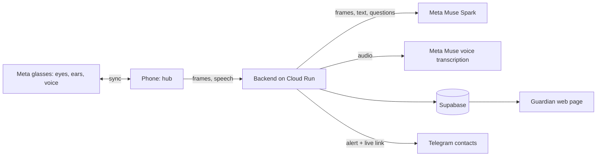

# Safeguard

**Demo video:** <!-- add link here -->

Picture a woman walking home after dark. Someone falls in step behind her, close enough that she can hear them breathing. She does not reach for her phone. She does not have to. Her glasses have already seen the stranger, heard the words, and decided that this is not a normal evening. A calm voice in her ear asks, "Are you safe?" When she does not answer, her family's phones light up with a live map, a live video and a route to the nearest police station, while a recording that cannot be taken away from her starts to build in the cloud.

That is Safeguard: a personal-safety system for women, designed for **Meta glasses**. The glasses are the eyes. They see what she sees, hear what she hears, detect danger and speak to her directly. A paired phone stays in sync as the hub for connectivity, alerts and recording.

This repository is a working demonstration of that system. Meta glasses are not yet open to developers as a camera source, so the demo uses an iPhone camera in their place, and any body camera or phone camera can play the same role. Everything described below runs today.

> Safeguard judges behaviour only: movement, approach, gestures, persistence. It never considers appearance, identity or clothing.

| Role | Meta glasses | Demo stand-in |
|---|---|---|
| Eyes: first-person camera | Glasses camera | iPhone camera or any body cam |
| Ears: microphone | Glasses microphone | iPhone microphone |
| Detector: people, gestures, expressions | Runs on the glasses, synced to the phone | Runs on the iPhone |
| Voice to the wearer: "Are you safe?" | Glasses speakers, private and hands-free | Phone speaker |
| Hub: network, alerts, recording | Paired phone, in sync at all times | The same iPhone |

The camera source and the spoken check-in sit behind narrow interfaces, so the glasses replace the stand-in without touching detection, judgment or escalation.

---

## When it matters: four things happen at once

The moment the countdown ends without a "safe" from her, Safeguard does not take turns. Four tracks start together, each reporting its own progress, and one failing never holds up the others. Nothing needs her hands. The only action left to her is the police call, and Safeguard never dials by itself.

<table>
<tr>
<td width="250" valign="top"></td>
<td valign="top">

**What you are seeing.** The SOS screen, a few seconds after it opened. The map already knows where she is, has found the nearest police station and drawn a walking route there, with the time it will take. Beneath it sit the two calls she may want to make herself, 112 and the women's helpline 1091, and a deliberate three-second hold to end the SOS, so a stray touch cannot cancel it.

</td>
</tr>
</table>

<table>
<tr>
<td width="300" valign="top"></td>
<td valign="top">

**What you are seeing.** The four tracks, all complete. In a real emergency each ticks over within seconds.

1. **Route.** The phone waits for a precise location fix, searches for the nearest police stations and hospitals, chooses the closest and draws a walking route with distance and time. She sees help, not a spinner.
2. **Contacts.** Every emergency contact receives a Telegram message in her language: who needs help, a live link, a map pin and exact coordinates. The pin keeps updating, so they watch her move. Contacts can share their own location with the bot once, and then the nearest one is told "You appear to be the nearest contact, about 1.2 km away", while the others hear how far the nearest is.
3. **Live stream.** The same message carries a link that opens in any browser, with no app and no sign-in: a live map, her trail and her video with sound.
4. **Cab.** Booking a ride through Uber's own Rides API requires Uber's approval, so Safeguard uses an Uber deep link. One tap opens Uber with her pickup and the nearest safe place already filled in. The same prefilled ride link goes to her contacts, so a brother across the city can send a cab to her from his own phone.

</td>
</tr>
</table>

---

## The recording that cannot be taken away

Most recordings die with the phone. Safeguard's does not. From the moment the SOS starts, video and sound are written in two-second pieces and each piece is uploaded the instant it exists. A guardian watching the live link sees the scene a few seconds behind real time. If the phone is snatched, dropped or switched off, everything uploaded up to that moment is safe, and the guardian can still play it afterwards as a single recording with the sound in sync.

<table>
<tr>
<td width="250" valign="top"></td>
<td width="250" valign="top"></td>
<td valign="top">

**What you are seeing.** The guardian page, the web page the person she trusts opens with a private code. No app, no account, nothing that can be changed or deleted.

*Left:* the incident list. Each entry shows who, when, how long it lasted and the size of the continuous recording.

*Right:* inside an incident. The red line is her trail, drawn from the location points the phone sent while she moved, fitted to the map so the whole walk is visible at a glance. Below the map sits the video player.

*Staged demo data.* Guardians can also ask to be alerted: one tap links their Telegram, and the moment an SOS starts they receive the same message and live link as her contacts.

</td>
</tr>
</table>

---

## Names heard, plates seen, moments captured

A recording tells a guardian what happened. The evidence log tells them who and what to look for. Beneath the video, the guardian page keeps a running log of three things Safeguard noticed during the incident, and every entry carries an honest rating: **possible** or **strongly possible**, never certain, because a device that guesses should say so. The log is kept from the moment protection starts, as a quiet *protection session* on the guardian page, so names and plates are there even before an SOS begins. Muse reads the conversation for names; the phone's own spotter takes over if Muse cannot be reached.

<table>
<tr>
<td width="330" valign="top"></td>
<td valign="top">

**What you are seeing.** The evidence log of a staged incident: one number plate, two names and one gesture moment, each with its time and its rating.

- **Names heard.** As the conversation near her is judged by Muse, the names people say are lifted out and rated by how sure the model is that a name was really spoken. Each entry keeps the sentence it came from, such as "Rahul, ruk jao, mujhse baat karo", so a guardian can judge it for themselves. Hindi, English and Hinglish are all understood.
- **Number plates.** The phone reads text on vehicles on the device itself, with Apple's text recognition, and accepts only text that looks like a real Indian plate: a valid state code, a district, a series and four digits, with common misreads corrected by position. A plate read once is "possible". A plate read again at least a second later is "strongly possible", and the log shows how many times it was seen.
- **Gesture moments.** When a hostile hand gesture is counted, Safeguard keeps a screenshot of that exact moment. Each screenshot carries an **Ask Muse about this moment** button.

</td>
</tr>
</table>

<table>
<tr>
<td width="330" valign="top"></td>
<td valign="top">

**What you are seeing.** A guardian tapping "What is happening here?" on a captured moment and reading Muse's answer. Ready-made questions sit above a free-text box, so nobody has to know what to ask.

Muse looks at the still image and describes behaviour: what the hands are doing, what is held, what is unclear. It is told never to describe or guess appearance, identity, age or clothing, never to name or accuse anyone, and to say so when the picture is too blurry to tell. In this staged example it says exactly that: a raised arm, a loose fist, a desk behind, and finer details that cannot be made out. A tool that admits what it cannot see is one a guardian can trust.

*Privacy.* Notes and screenshots are kept on the phone for at most ten minutes while she is protected, and sent only when an SOS incident exists. They are visible only to the guardian code she shared.

</td>
</tr>
</table>

---

## The rest of the story

**She is watched over before anything goes wrong.** Once she taps Start on the Dashboard, a full-screen live view opens and the phone begins to watch and listen.

- **Seeing.** People are found and followed on the device. Hand gestures and facial expressions are read in real time. Repeated hostile gestures count toward an automatic SOS.
- **Understanding.** Every few seconds Muse looks at a short burst of what the camera saw and decides how worrying it is, from behaviour alone. It names the object in the hand and shows it live on screen as "Muse sees: a bottle, threat low". A raised bottle, a knife or a box cutter pointed at her is rated high, even when the person looks calm, while a pen or a phone held calmly is not.
- **Listening.** Muse also reads the conversation near her, in English, Hindi or Hinglish, for threats, coercion, pursuit and unwelcome advances. Distress words such as "bachao" or "help me", shouting, and her own code phrase are caught on the device too, even with no signal.
- **Asking.** When something looks wrong, the app does not jump to alarm. It asks aloud whether she is safe. A safe phrase or a tap cancels it at once. If she says nothing, a countdown begins, and she can still cancel it.

**She can protect a journey, not just a moment.** The safe-arrival timer lets her say "I will be home in thirty minutes". If she has not tapped "I'm safe" by then, the same countdown starts.

**She is never more than a tap from help.** The Dashboard carries 112, the women's helpline 1091 and the 181 line for women in distress, and "Police near me" and "Hospitals near me" open the map straight away.

**It keeps working when the network does not.** Detection, the voice check-in, the countdown, the helplines and the timer all run on the device. If the server cannot be reached, she can carry on in offline mode, and alerts and recordings are sent as soon as the connection returns.

**Everyone is accountable.** An account is required, so every alert has a name behind it, and a profile photo is optional. Passwords never touch Safeguard: they go straight to the sign-in service.

---

## How Meta's models are used

Meta's Muse models are the judgment layer. Fast, private checks run on the device, and anything that needs understanding goes to Muse through the Meta Model API. Muse is called only from the backend, so no key ever reaches a device.

**Muse Spark: scene judgment.** A short burst of first-person frames, up to eight, is sent with the on-device findings (people tracked, approach speed, hostile gestures, angry expressions, shouting). Muse Spark reads them as a human reviewer would and returns strict JSON: a threat level, a confidence, the behaviours it observed, the object held in the hand, and one short reason. Its prompt and an output filter forbid any reference to appearance or identity. While someone stays close, the scene is checked every ten seconds, and the model runs at minimal reasoning effort so each verdict returns in about three seconds.

**Muse Spark: conversation judgment and names.** Speech overheard near the wearer is judged for meaning and intent, not keywords: threats, coercion, pursuit, unwanted advances, abuse, a cry for help, and whether it is aimed at her. The same call lifts out the personal names that were spoken, each with a confidence that becomes the "possible" or "strongly possible" rating.

**Muse Spark: questions about a moment.** A guardian's question about a captured screenshot goes to Muse with the image. The answer describes behaviour only and says when the picture is unclear.

**Muse voice transcription: the cloud ear.** The device streams microphone audio to the backend, which relays it to Meta's realtime speech recognition. Hindi and English distress words and unsafe phrases are recognised with endpointing and keyword boosting, and partial results stream back within the second. Audio is relayed, never stored, and transcripts are never logged.

**How the layers work together.** The device decides in milliseconds and keeps working offline. Muse adds understanding and reduces false alarms: a clip or a sentence that looks alarming to a simple rule can be rated low, and a quiet but menacing one rated high. The escalation logic combines both. With Meta glasses, the same Muse calls apply unchanged, with frames and audio coming from the glasses instead of the iPhone.

---

## Technology stack

| Layer | Technology | Used for |
|---|---|---|
| Language models | **Meta Muse Spark** via Meta Model API (OpenAI-compatible chat completions, vision input, strict JSON) | Scene judgment, conversation judgment, names, questions about a moment |
| Speech recognition | **Meta Muse voice transcription** (realtime websocket) | Distress words in Hindi and English |
| iOS app | Swift, SwiftUI, iOS 17 | Interface, protection state machine, escalation |
| People detection | Apple Vision | Person boxes, tracking, approach speed |
| Gestures and expressions | MediaPipe Tasks Vision, GPU delegate | Hand gestures including finger geometry, face blendshapes for anger, surprise and similar |
| Number plates | Apple Vision text recognition | On-device plate reading with Indian-format validation |
| On-device speech | Apple Speech | Immediate, offline phrase recognition |
| Camera and audio capture | AVFoundation | Frames, microphone tap |
| Recording | AVAssetWriter fragmented MP4 (HLS), H.264 and AAC | One continuous recording with sound, uploaded piece by piece as it is written |
| Maps and nearby help | MapKit, CoreLocation | Accurate location, nearby police and hospitals, walking routes |
| Ride | Uber deep link | Prefilled pickup and drop-off, no API approval needed |
| Backend | FastAPI (Python) on Google Cloud Run | Muse calls, alerts, links, recordings, evidence log, accounts |
| Accounts | Supabase Auth, relayed through the backend | Sign-up and sign-in; passwords never stored by Safeguard |
| Device trust | Per-install signed tokens (HMAC), Keychain | Authorises the app to the backend with no shared secret shipped |
| Database | Supabase Postgres with row-level security | Profiles |
| Object storage | Supabase Storage | Recordings, incident state, profile photos, captured moments |
| Alerts | Telegram bot by webhook | Contact and guardian alerts with a live link, nearest-contact ranking |
| Live and guardian pages | Server-rendered web pages, hls.js, Leaflet, signed media links | Live view, playback, trail map, evidence log |

*Why Telegram?* This demo was built to keep the running cost at zero, so alerts go out through a Telegram bot, which is free. WhatsApp or SMS would be the ideal channel for a real deployment, because every contact already has them; the alert code is isolated in one module so the channel can be swapped without touching detection or recording.

---

## Principles

- **Behaviour, never identity.** Prompts, filters and rules exclude appearance entirely.
- **Automatic except the police call.** Safeguard never dials by itself.
- **Private by default.** Detection runs on the device. Keys stay on the server. Passwords are never stored by Safeguard. Transcripts are not logged, and captured moments leave the phone only when an incident exists.
- **Honest about uncertainty.** Names, plates and gestures are rated "possible" or "strongly possible", and Muse says when an image is unclear.
- **No shared secret in the app.** Each install registers itself and receives its own signed token, stored in the Keychain and revocable from the server.

## Run it on an iPhone

Open `ios/Safeguard.xcodeproj` in Xcode, choose your team under Signing & Capabilities, and press Run. The app connects to the hosted backend on its own and needs nothing else.

## Layout

- `ios/` native app
- `backend/` FastAPI service and tests
- `supabase/` database migrations
- `scripts/` build, test and deploy scripts
- `deploy/` hosting notes
- `docs/images/` screenshots used above

## Status

A working demo with an iPhone camera as the stand-in for Meta glasses. Next: the glasses as the live camera and microphone source, with spoken prompts to the wearer.
