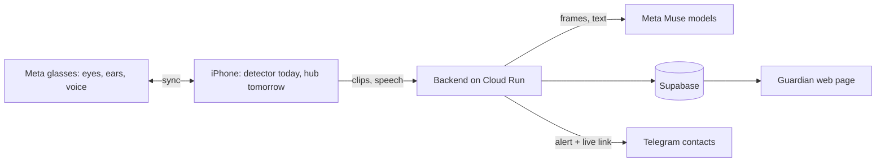

# Safeguard

**Demo video:** <!-- add link here -->

Safeguard is a personal-safety system for women, built as a working demonstration of one idea: **Meta glasses can be the eyes**.

Today an iPhone worn on the chest plays the role of the detector. It sees what is in front of the wearer, listens to the conversation, decides whether something is wrong, and escalates. The proposal is to move that role to Meta glasses, which see from the wearer's own point of view, stay in sync with the phone at all times, and speak to the wearer directly. The phone then becomes the hub: connectivity, alerts and recording. This repository shows how both halves behave, so the glasses can drop in without changing the rest of the system.

> Safeguard judges behaviour only: movement, approach, gestures, persistence. It never considers appearance, identity or clothing.

## The idea

| Role | Today (demo) | With Meta glasses |
|---|---|---|
| Eyes: camera and first-person view | iPhone camera, chest or collar mount | Glasses camera |
| Ears: microphone | iPhone microphone | Glasses microphone |
| Detector: gestures, faces, people | On the iPhone | On the glasses, synced to the phone |
| Voice to the wearer: "Are you safe?" | Phone speaker | Glasses speakers, private and hands-free |
| Hub: network, alerts, recording | iPhone | iPhone, kept in sync with the glasses |

The app is built so that the camera source is a replaceable input. Frames, audio and the spoken check-in all pass through narrow interfaces, which is what makes the swap realistic.

## End-to-end flow

1. **Sign in.** An account is required. A profile photo is optional.
2. **Protect.** The wearer starts protection. The phone watches the scene and listens.
3. **Detect on the device.** People, hand gestures and facial expressions are read in real time. Repeated hostile gestures, a distress word, shouting or an unsafe phrase raise concern.
4. **Judge in the cloud.** Short clips and speech snippets go to Meta's Muse model, which rates the threat from behaviour alone.
5. **Ask.** The app asks the wearer by voice whether she is safe. A safe phrase or a tap cancels it.
6. **Countdown.** With no reply, a cancellable countdown starts.
7. **Escalate, automatically.** Contacts and the guardian get a Telegram alert with a live link and map pin. Video and sound stream to the cloud as one continuous recording. A ride link is prepared. Only the police call is left to the wearer, by design.
8. **Review.** The guardian watches live from any browser, and afterwards plays the incident as a single recording with sound.

Also included: a safe-arrival timer, helplines (112, 1091, 181), nearby police and hospitals, and an offline mode if the server is unreachable.

## Technology and where it is used

### Meta models

| Model | Role |
|---|---|
| **Muse Spark** (Meta Model API) | Multimodal threat judgment over short first-person clips: behaviours, objects in hand, approach, persistence. Also judges conversation snippets. Returns strict JSON. |
| **Muse voice transcription** (Meta realtime ASR) | Cloud ear: streaming Hindi and English speech recognition for distress words and unsafe phrases, relayed through the backend so keys never reach the phone. |
| **SAM 2** (optional) | Local video segmentation of people in a clip, used when a checkpoint is installed. |

Meta glasses are the intended sensor for all of the above.

### On the device and in the cloud

| Layer | Technology |
|---|---|
| iOS app | Swift, SwiftUI, iOS 17 |
| Person detection | Apple Vision |
| Gestures and expressions | MediaPipe Tasks Vision (hand gestures, face blendshapes) |
| On-device speech | Apple Speech |
| Recording | AVAssetWriter, fragmented MP4 (HLS), AAC audio, uploaded as it is written |
| Maps and nearby help | MapKit |
| Backend | FastAPI (Python) on Google Cloud Run, scales to zero |
| Accounts and storage | Supabase Auth, Postgres (profiles, row-level security), Storage (recordings, state, photos) |
| Alerts | Telegram bot by webhook |
| Guardian page | Server-rendered page with hls.js playback and signed media links |



## Principles

- **Behaviour, never identity.** Prompts and rules exclude appearance entirely.
- **Automatic except the police call.** Safeguard never dials by itself.
- **Private by default.** Detection runs on the device. Keys stay on the server. Passwords are never stored by Safeguard. Transcripts are not logged.
- **Cheap to run.** One Cloud Run instance, none kept warm, with a cost check on every deploy.

## Run it

Prerequisites: Xcode with an iOS platform, Python 3.11+, a physical iPhone for the camera (the Simulator has a replay mode).

```sh
cp .env.example .env
cd backend && python3 -m venv .venv && source .venv/bin/activate
pip install -r requirements.txt
python -m uvicorn app.main:app --host 0.0.0.0 --port 8000
```

Build the app to a phone, pointing it at a backend:

```sh
DEVELOPMENT_TEAM=<TeamID> BACKEND_BASE_URL=https://<your-backend> ./scripts/build.sh device
```

Tests: `./scripts/test.sh` (app) and `cd backend && python -m pytest` (backend).

Cloud deployment: see [deploy/CLOUD_RUN.md](deploy/CLOUD_RUN.md). Demo walkthrough: [DEMO.md](DEMO.md). Design notes: [DECISIONS.md](DECISIONS.md).

## Layout

- `ios/` native app
- `backend/` FastAPI service and tests
- `supabase/` database migrations
- `scripts/` build, test, deploy and cost-check scripts
- `deploy/` hosting guide

## Status

A working demo on a physical iPhone. Planned: glasses as the live camera and microphone source with spoken prompts, Meta's Omnilingual ASR for regional languages, a custom on-device object detector, and a server-side safe-arrival timer.

Keys come from environment variables only. A pre-commit hook blocks secrets: `cp scripts/pre-commit.sh .git/hooks/pre-commit`.
