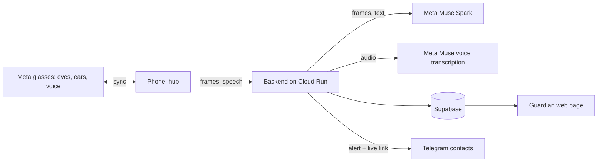

# Safeguard

**Demo video:** <!-- add link here -->

Safeguard is a personal-safety system for women, designed for **Meta glasses**. The glasses are the eyes: they see what the wearer sees, hear what she hears, detect danger, and speak to her directly. A paired phone stays in sync as the hub for connectivity, alerts and recording.

This repository is a working demonstration of that system. Meta glasses are not yet available as a developer camera source, so the demo uses an iPhone camera in their place. Any body camera or phone camera can play the same role. The detection, judgment, voice check-in, alerts and guardian review shown here are exactly what the glasses would drive.

> Safeguard judges behaviour only: movement, approach, gestures, persistence. It never considers appearance, identity or clothing.

## The idea

| Role | Meta glasses | Demo stand-in |
|---|---|---|
| Eyes: first-person camera | Glasses camera | iPhone camera or any body cam |
| Ears: microphone | Glasses microphone | iPhone microphone |
| Detector: people, gestures, expressions | Runs on the glasses, synced to the phone | Runs on the iPhone |
| Voice to the wearer: "Are you safe?" | Glasses speakers, private and hands-free | Phone speaker |
| Hub: network, alerts, recording | Paired phone, in sync at all times | The same iPhone |

The camera source and the spoken check-in sit behind narrow interfaces, so the glasses replace the stand-in without changing detection, judgment or escalation.

## End-to-end flow

1. **Sign in.** An account is required. A profile photo is optional.
2. **Protect.** The wearer starts protection. The camera watches and the microphone listens.
3. **Detect on the device.** People, hand gestures and facial expressions are read in real time. Repeated hostile gestures, a distress word, shouting or an unsafe phrase raise concern.
4. **Judge with Meta's Muse.** Short clips and speech snippets go to Muse, which rates the threat from behaviour alone.
5. **Ask.** The wearer is asked by voice whether she is safe. A safe phrase or a tap cancels it.
6. **Countdown.** With no reply, a cancellable countdown starts.
7. **Escalate automatically.** Contacts and the guardian get a Telegram alert with a live link and map pin. Video and sound stream to the cloud as one continuous recording. A ride link is prepared. Only the police call is left to the wearer, by design.
8. **Review.** The guardian watches live from any browser, then plays the incident as a single recording with sound.

Also included: a safe-arrival timer, helplines (112, 1091, 181), nearby police and hospitals, and an offline mode if the server is unreachable.

## Escalation: four parallel tracks

When the countdown ends, four tracks start at the same moment. Each reports its own status on the SOS screen, and one failing never blocks the others.

1. **Contacts.** The backend sends every linked emergency contact a Telegram alert in the wearer's language: who needs help, a live link, a map pin and the exact coordinates. Location keeps updating after the first message, so contacts see movement and not a single point. Contacts can share their own location with the bot once, voluntarily. The server then ranks them by distance and tells the nearest one that they are closest, and everyone else how far the nearest contact is.
2. **Live stream.** The same alert carries a live link. It opens in any browser, with no app and no sign-in, and shows the live map, the trail and the video with sound as one continuous recording. The link is hosted by the backend on Google Cloud Run, and the guardian page plays the finished recording afterwards.
3. **Route.** The phone waits for a precise location fix, then finds the nearest police stations and hospitals with MapKit, picks the closest, and draws a walking route with a distance and time. The wearer sees where help is.
4. **Cab.** Booking a ride directly requires approval for Uber's Rides API, so Safeguard uses an Uber deep link. One tap opens Uber with the pickup already set to the wearer's location and the drop-off set to the nearest safe place. The same prefilled ride link goes to contacts in their alert, so a contact can send a cab to the wearer from their own phone.

The wearer can also place the police call with one tap. Safeguard never dials by itself.

## How Meta's models are used

Meta's Muse models are the judgment layer. Fast, private checks run on the device; anything that needs understanding goes to Muse through the Meta Model API, called only from the backend so no key ever reaches a device.

**Muse Spark: scene judgment.** A short burst of first-person frames, up to eight JPEGs, is sent together with the on-device findings (people tracked, approach speed, hostile gestures, angry expressions, shouting). Muse Spark reads the frames as a human reviewer would and returns strict JSON: a threat level (low, medium or high), a confidence, the behaviours it observed and one short reason. It is asked to notice objects held, raised or pointed at the wearer, reaching and lunging, blocking, fixed staring at close range and indecent behaviour, and to treat ordinary scenes and calmly held objects as safe. Its prompt and an output filter forbid any reference to appearance or identity.

**Muse Spark: conversation judgment.** Speech overheard near the wearer, in English, Hindi or Hinglish, is judged for meaning and intent rather than keywords: threats, coercion, pursuit, unwanted advances, abuse or a cry for help, and whether it is directed at the wearer. The result is a severity, categories and a one-line reason. Friendly talk, music and television rate low.

**Muse voice transcription: the cloud ear.** The device streams microphone audio to the backend, which relays it to Meta's realtime speech recognition. Hindi and English distress words and unsafe phrases are recognised with endpointing and keyword boosting, and partial results stream back within the second. Audio is relayed, never stored, and transcripts are never logged.

**How the layers work together.** The device decides in milliseconds and keeps working offline. Muse adds understanding and reduces false alarms: a clip or a sentence that looks alarming to a simple rule can be rated low, and a quiet but menacing one rated high. The escalation logic combines both.

With Meta glasses, the same Muse calls apply unchanged. Frames and audio come from the glasses instead of the iPhone.

## Technology stack

| Layer | Technology | Used for |
|---|---|---|
| Language models | **Meta Muse Spark** via Meta Model API (OpenAI-compatible chat completions, vision input, strict JSON) | Scene and conversation judgment |
| Speech recognition | **Meta Muse voice transcription** (realtime websocket) | Distress words in Hindi and English |
| iOS app | Swift, SwiftUI, iOS 17 | Interface, protection state machine, escalation |
| People detection | Apple Vision | Person boxes, tracking, approach speed |
| Gestures and expressions | MediaPipe Tasks Vision, GPU delegate | Hand gestures including finger geometry, face blendshapes for anger, surprise and similar |
| On-device speech | Apple Speech | Immediate, offline phrase recognition |
| Camera and audio capture | AVFoundation | Frames, microphone tap |
| Recording | AVAssetWriter fragmented MP4 (HLS), H.264 and AAC | One continuous recording with sound, uploaded piece by piece as it is written |
| Maps and nearby help | MapKit, CoreLocation | Accurate location, nearby police and hospitals, walking routes |
| Ride | Uber deep link | Prefilled pickup and drop-off, no API approval needed |
| Backend | FastAPI (Python) on Google Cloud Run | Muse calls, alerts, links, recordings, accounts |
| Accounts | Supabase Auth, relayed through the backend | Sign-up and sign-in; passwords never stored by Safeguard |
| Device trust | Per-install signed tokens (HMAC), Keychain | Authorises the app to the backend with no shared secret shipped |
| Database | Supabase Postgres with row-level security | Profiles |
| Object storage | Supabase Storage | Recordings, incident state, profile photos |
| Alerts | Telegram bot by webhook | Contact and guardian alerts with a live link |
| Live and guardian pages | Server-rendered web pages, hls.js, signed media links | Live view and playback, no app needed |

## Principles

- **Behaviour, never identity.** Prompts, filters and rules exclude appearance entirely.
- **Automatic except the police call.** Safeguard never dials by itself.
- **Private by default.** Detection runs on the device. Keys stay on the server. Passwords are never stored by Safeguard.
- **No shared secret in the app.** Each install registers itself and receives its own signed token, stored in the Keychain and revocable from the server.

## Run it on an iPhone

Open `ios/Safeguard.xcodeproj` in Xcode, choose your team under Signing & Capabilities, and press Run. The app connects to the hosted backend on its own and needs nothing else.

## Layout

- `ios/` native app
- `backend/` FastAPI service and tests
- `supabase/` database migrations
- `scripts/` build, test and deploy scripts
- `deploy/` hosting notes

## Status

A working demo with an iPhone camera as the stand-in for Meta glasses. Next: the glasses as the live camera and microphone source, with spoken prompts to the wearer.
